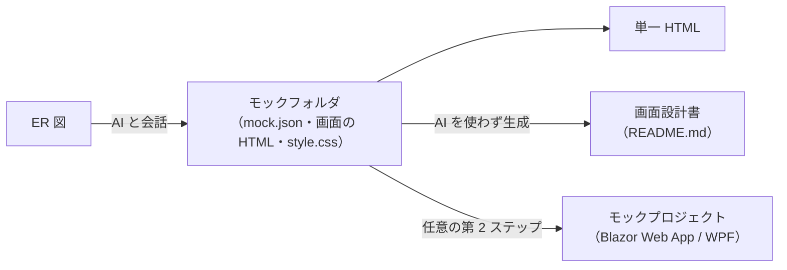
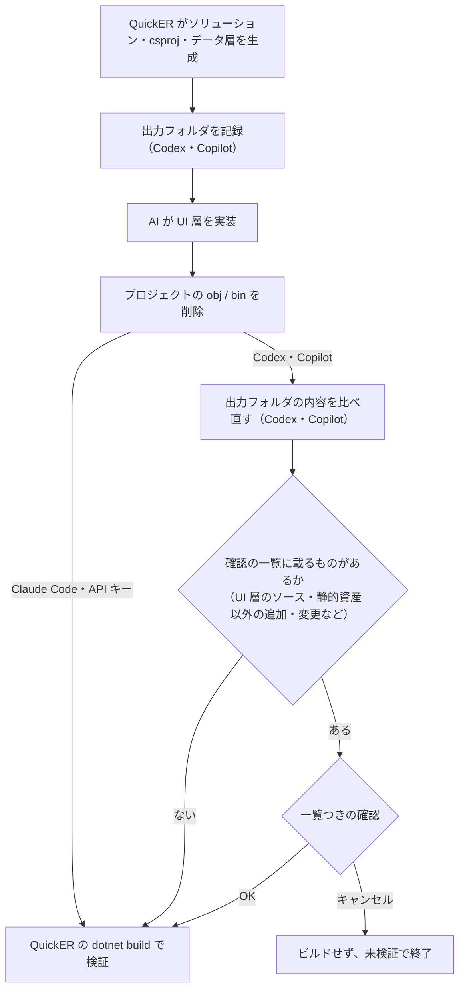

# AI チャットの設定

*[English](ai-chat.md) | 日本語*

ツールバーの「AI チャット」から、対話で ER 図を生成・編集できます（例:「EC サイトの注文管理に必要なテーブルを設計して」「orders に配送先住所を追加して」）。
同じ接続設定で、現在の ER 図から Web モック画面を生成する「AI モック生成」も利用できます（下記[AI モック生成](#ai-モック生成)を参照）。

この内蔵チャットは GUI で現在開いている図を編集します。
外部の AI エージェント（Claude Code・Codex など）に、自身のワークフローの一部として QuickER を駆動させたい場合は、[MCP サーバ](mcp.ja.md)を使ってください。

## 接続方式

チャット画面の接続タブは 4 つです。
API キータブの中でさらに 3 プロバイダーを選べるため、接続方式としては 6 種あります。

| タブ | 接続方式 | 認証 | 添付できる種別 |
|---|---|---|---|
| API キー | OpenAI | OpenAI の API キー | 画像・テキスト |
| API キー | Claude (Anthropic) | Anthropic の API キー | 画像・PDF・テキスト |
| API キー | Local LLM | 認証を課すサーバーなら API キー（任意） | 画像・テキスト |
| Codex | Codex CLI | インストール済みの Codex CLI のアカウント認証 | 非対応 |
| Claude Code | Claude Code | インストール済みの Claude Code のアカウント認証 | 画像・PDF・テキストと、その他のバイナリ |
| Copilot | GitHub Copilot CLI | インストール済みの GitHub Copilot CLI のアカウント認証（GitHub Copilot のサブスクリプションが必要） | 画像のみ |

### 1. API キー（「API キー」タブ）

| プロバイダー | 必要なもの |
|---|---|
| OpenAI | OpenAI の API キー |
| Claude (Anthropic) | Anthropic の API キー |
| Local LLM | OpenAI 互換 API のローカル LLM（Ollama・LM Studio・llama.cpp・vLLM など） |

プロバイダーとモデルを選び、API キーを入力します。
「保存」を有効にすると、キーは **Windows DPAPI（CurrentUser スコープ）で暗号化**されてユーザープロファイル配下に保存され、次回起動時に自動入力されます（平文では保存されません）。
キーを保存するのは、キー欄から離れたとき・プロバイダーを切り替えたとき・ウィンドウを閉じたときです（1 文字打つごとには保存しません）。
DPAPI の CurrentUser 保護は Windows のユーザーアカウントに紐づくため、保護の強さはそのアカウントの安全性に依存します。

「Local LLM」では、エンドポイント欄にサーバーの URL を指定します（`/v1` まで含めます。既定は Ollama の `http://localhost:11434/v1`）。
API キーは任意で、認証不要のサーバーなら空のまま、認証を課すサーバーなら入力します。
選んだプロバイダーとエンドポイントは記憶され、次回起動時に復元されます。

### 2. Codex（「Codex」タブ）

インストール済みの Codex CLI のアカウント認証を利用します（API キー不要）。
`config.toml` に定義したプロバイダーも候補に表示されます。

### 3. Claude Code（「Claude Code」タブ）

インストール済みの Claude Code のアカウント認証を利用します（API キー不要）。
モデルはエイリアス（sonnet など）から選択します。

### 4. Copilot（「Copilot」タブ）

インストール済みの GitHub Copilot CLI のアカウント認証を利用します（API キー不要。GitHub Copilot のサブスクリプションが必要です）。
モデルの候補は接続後に実行時列挙され（選べるモデルは Copilot のプランに依存します）、空のままにすると CLI の既定モデルを使います。

最後に使った接続タブは記憶され、次回起動時に自動選択されます。
応答の実行中は接続タブが無効になります。
切り替える前に応答を中断してください。
「新しい会話」の開始を待つ間も、接続タブは無効になります。

## できること

- **図の生成**：要件を伝えるとテーブル・カラム・リレーションを作成。
  空の図から始めた応答でテーブルができると、応答の終わりに図全体を自動整列します。
  応答が失敗したときや中断したときも、できたテーブルは整列します。
- **図の編集**：既存の図に対する追加・変更・削除。
  テーブル・カラム・リレーションの操作は Undo/Redo 履歴に乗るため元に戻せます。
  名前付きクエリの更新は履歴を経由せず直接反映されます。
  1 回の応答のツール実行は最大 50 往復で、上限に達した応答は失敗として打ち切られます。
- **添付**：ファイルを添付して、既存の設計資料などを文脈として渡せます。
  種別ごとにサイズ上限があり、添付できる種別は接続方式によって変わります（[接続方式](#接続方式)の表を参照）。
  添付は、応答が完了したときに消えます。
  応答が失敗したときや中断したときは残るので、そのまま送り直せます。
- **AI モック生成**：現在の ER 図から Web モック画面を生成し、モックフォルダとして保存（下記参照）

## 回答の表示

AI チャットと AI モック生成では、AI の回答を Markdown として整形して表示します。
見出し・太字と斜体・インラインコード・コードブロック・箇条書きと番号付きリスト・表・引用・区切り線・リンクを整形します。
チャット欄の上にある「Markdown 表示」のチェックで、整形した表示と元の文章を切り替えます。
この設定はウィンドウごとに記憶され、既定はオンです。
応答中の回答は文章のまま表示します。
応答が終わると、完了・失敗・中断のどれでも整形した表示へ切り替わります。
文章だけの短い回答は文章の幅の吹き出しで表示し、表・コードブロック・リストを含む回答は吹き出しの最大幅で表示します。

- **リンク**：`http` と `https` のリンクだけを、確認なしで既定のブラウザで開きます。
  リンクにマウスを乗せると、実際に開く URL が表示されます。
  それ以外のリンク（`file:` のリンク・ネットワーク上のパス・アプリを起動するリンクなど）は、クリックできない普通の文字として表示します。
- **画像**：画像は読み込まず、代替テキストだけを表示します。
  回答の中の画像のために、QuickER が外部のサーバーへ接続することはありません。
- **HTML**：回答の中の HTML は解釈せず、書かれたとおりの文字として表示します。
- **入れ子が深すぎる回答**：引用や強調を何十段も重ねた回答のように、整形できない回答は文章のまま表示します。
- **コピー**：整形した表示でコピーすると、表示されている文章がコピーされます。
  元の Markdown をコピーするときは、「Markdown 表示」のチェックを外してから文章の表示でコピーします。

## AI モック生成

「AI モック生成」は現在の ER 図から Web モック画面を起こします。
成果は**モックフォルダ**（`mock.json` マニフェスト＋画面ごとの HTML＋共有 `style.css`）として保存され、会話しながらライブで書き出されます。

### モックフォルダ

空フォルダを指定すれば新規に、既存のモックフォルダを指定すれば続きから作れます。
フォルダはフルパスで指定します（`mock` のような相対パスでは会話を始められません）。
フォルダ欄の入力は、打つのが止まったとき、欄から離れたとき、Enter を押したときに確定し、その時点でフォルダの中身を読みます。
会話履歴は保存せず、再開の材料はフォルダの内容だけなので、どのバックエンドでも同じように続きから作れます。
再開すると、前に成功した会話から ER 図が変わったかを AI へ伝えます。
比べる ER 図は、会話の最初のターンが成功したときに記録します。
最初のターンが失敗・中断で終わったときは何も記録せず、次の送信で会話を始め直します。
画面一覧サイドバーから画面をクリックで切り替えられ、プレビューは画面間のリンク遷移に追従します。

### 単一 HTML

モック全体は自己完結の単一 HTML ファイルとして出力できます。
このファイルでは、別の画面へのリンクはその画面を開きますが、画面の中の `#section` の位置まではスクロールしません。
ページ内のリンクでは、表示中の画面がそのまま残ります。
画面の HTML に対応の取れていない `</section>` タグがあると、単一 HTML 出力で画面の区切りが乱れ、後続の画面へ内容がはみ出すことがあります。

### 画面設計書

モックフォルダからは画面設計書（`README.md`＝画面一覧・Mermaid の遷移図・画面×エンティティの CRUD 表・画面ごとの項目表）を AI を使わず決定的に生成することもできます。
一度出力すると、以降は画面の保存・削除に合わせて自動で書き直され、GitHub でフォルダを開くとフォルダのトップに表示されます。
AI は画面を保存する際に各画面のエンティティ使用（CRUD）を宣言し、その宣言が画面×エンティティ表として載ります（宣言が 1 件も無ければ表は省略されます）。

### モックプロジェクト

任意の第 2 ステップとして、モックフォルダから実行可能な**モックプロジェクト**を 4 バックエンドのいずれでも生成できます。
ターゲットは **Blazor Web App**（既定）か **WPF (.NET)** です。
Blazor Web App はグローバルに InteractiveServer で対話動作し、各画面の HTML と共有 `style.css` を可能な限りそのまま移植して web ネイティブに再現します。
ソリューション・csproj・データ層コード（Entity / EditModel / Mapper / インメモリ Repository。図の方言が対応していれば QuickER 版 Repository も）は ER モデルから QuickER が決定的に生成するため、AI が書くのは UI 層だけです。
モックフォルダは `design/mock/` に同梱され、AI がそれを基に UI を実装します。
生成される csproj は QuickER 本体と同じ版のパッケージを参照し、`Microsoft.Data.Sqlite` が持ち込む脆弱な版を上書きする修正済みの `SQLitePCLRaw` も含みます。
SQL Server の Blazor のプロジェクトは、`Microsoft.Data.SqlClient` が持ち込む脆弱な版を上書きする修正済みの `System.Security.Cryptography.Pkcs` も参照します。WPF は共有フレームワークがこのパッケージを持つので参照しません。

Claude Code / Codex / Copilot はエージェントがファイルを編集し、`dotnet build` が通るまで（または実行全体の時間上限に達するまで）自己修正します。
エージェントにはソリューションを名指ししたビルド（`dotnet build <プロジェクト名>.sln`）を指示するため、出力フォルダに別のソリューションやプロジェクトがあっても妨げになりません。
API キーはモデルが決定的な一発生成でファイルを提出する方式（自己修正なし・ビルド失敗時のみ修正 1 回）のため、失敗することがあります。
いずれの場合も、最後は QuickER 自身の `dotnet build` で結果を検証します。
追加指示欄から、その実装への追加の指示を渡せます。

生成から最後の検証ビルドまでの流れは次のとおりです。
AI が書いたコードをビルドするときの権限と確認は、[注意](#注意)を参照してください。

出力フォルダに既存のファイル・フォルダがあるときは、生成前に一覧つきの確認が出ます。
生成はソリューション・csproj・`README-QuickER.md` を同名で上書きし（同じプロジェクト名での作り直しはこれで行えます）、それ以外のファイルはそのまま残します。
`Generated/` と `design/mock/` は書き直す前に空にするため、別のデータベース向けに生成したコードや、削除した画面の HTML のような前回の残りは残りません。
選んだモックフォルダがこの 2 つのフォルダのどちらかと同じとき、その中にあるとき、またはそれを含むとき（前回の出力の `design/mock/` を指定した場合など）は、何も書き出す前に生成を止めるため、モックフォルダが消えることはありません。

この第 2 ステップは PoC・プロトタイピングの補助です。
AI のモデルと接続方式によってはビルドエラーが残ることがあります。
最終ビルドが失敗した場合も生成物とログは出力フォルダに残るため、手で修正して続行できます。
実行中の想定外のエラーは実行器の失敗と同じ形で報告し、ログ（`quickr-mock-generation.log`）はどの場合も書き出します。
中断はどの時点でも効き、最終ビルドの実行中も止められます。

## 注意

- API キー方式・Codex・Claude Code・Copilot のいずれも、図の内容（テーブル定義など）が選択した AI プロバイダーへ送信されます。
  機密性の高いスキーマを扱う場合は、所属組織のポリシーに従ってください
- AI 機能を使わない場合、API キー等の設定は不要です（ER 図デザイナ・コード生成はネットワークに接続せずに動作します）
- **添付したファイルと、再開したモックフォルダの中身は、「信頼できない入力」として AI に渡ります。**
  添付したテキストはそのままプロンプトへ埋め込まれ、添付した画像もそのまま渡されます。
  モックフォルダを再開すると、マニフェストのテキスト（画面名・説明・改訂メモ・遷移）がプロンプトへ注入され、各画面の HTML も AI が読み出した時点で会話へ入ります。
  いずれも「AI 宛ての指示が混ざっていないか」は検査されないため、他人が書いた内容が AI の挙動を（呼び出すツールも含めて）動かし得ます。
  第三者から受け取ったモックフォルダや設計資料は、その出所のファイル一般と同じ扱いをし、ここで開く前に中身を確認してください
- 第 2 ステップ（モックプロジェクト生成）は、**AI が書いたコードをあなたの PC 上でユーザー権限でビルドします**。
  AI に与えられる権限はバックエンドによって異なります

  | バックエンド | ファイル書き込み | コマンド実行 |
  |---|---|---|
  | API キー | `emit_file` による提出のみ。出力フォルダ配下かつ UI 層のソース拡張子（WPF は `.xaml` / `.cs`、Blazor は `.razor` / `.css` / `.cs`）に限られ、ビルド設定ファイル（`.csproj` / `Directory.Build.props` など）や `Generated/` `design/` `obj/` `bin/` への提出は拒否されます（Windows がこれらのフォルダとして開き得る、末尾が `.` や空白のセグメント・`~` を含むセグメントも拒否します） | なし |
  | Copilot | 出力フォルダ配下のみ自動承認 | URL 参照もファイルへの書き込みリダイレクトも無いコマンドに限り、パスがすべて出力フォルダ配下と判断できるときは自動承認。パスが読み取れないコマンドは、全要素が `dotnet` のときだけ自動承認し、それ以外は拒否します（ヘッドレス実行のため確認を出せません）。ただし `dotnet` 自体は出力フォルダに閉じないため、フォルダの外へ出るサブコマンド（グローバルツールの導入とその実行など）も自動承認されます |
  | Codex | サンドボックス（`workspace-write`）の内側 | サンドボックスの内側で承認なしに実行 |
  | Claude Code | 作業フォルダを起点にファイル編集（`Edit` / `Write` / `MultiEdit`） | `Bash` に制限なし（任意のコマンドを実行できます） |

- API キー方式は QuickER が制限付きのツールだけを与える設計です。
  エージェント型（Codex / Claude Code / Copilot）は、あなたが導入した CLI をその CLI 自身の権限モデルで動かすため、QuickER 側では制限しません。
  信頼できないスキーマや不特定の入力からモックを生成する場合は、API キー方式を選ぶか、隔離した環境で実行してください
- 最後の検証ビルドは全バックエンド共通で次の形で実行します。
  - **自分のソリューションをパスで明示**：出力フォルダに別のソリューションが同居していても対象が揺れません
  - **MSBuild の自動 import を無効化**：`Directory.Build.props` / `.targets`、`Directory.Solution.props` / `.targets`、`Directory.Packages.props`
  - **自動応答ファイルを無効化**：`Directory.Build.rsp` など
  - **MSBuild ノードと Roslyn コンパイラサーバーを使い捨て**：AI が書いたビルドタスクを常駐プロセスに残しません
  - **プロジェクトフォルダの `obj` / `bin` をビルド直前に削除**：`obj` に置かれたファイルはワイルドカード import で読み込まれるため

  一方、祖先フォルダの `global.json` と `NuGet.Config` は**そのまま効きます**（SDK のピンと社内フィードの設定を失うほうが実害が大きいため無効化していません）。
  ビルドには時間上限があり、超過すると打ち切ります
- **最終ビルドはエージェントのサンドボックスの外側で、あなたの権限で実行されます＝境界を越える唯一の地点です。**
  Codex と Copilot はサンドボックスの内側で csproj（あるいは `global.json`・`*.csproj.user`）を書けるため、このビルドがその内容を読み込んで実行し得ます。
  そこでこの 2 つのバックエンドでは、スキャフォールド直後の出力フォルダを記録し、ビルドの直前にファイルの内容を比べ直して、UI 層のソース・静的資産（`.cs` / `.razor` / `.xaml` / `.css` / `.js` / `.html` / 画像）以外の追加・変更があれば確認します。
  一覧は畳まず全件出すため、`appsettings.json` のような正当な追加もそこに並びます。
  フォルダのリンク（ジャンクション・シンボリックリンク）は名前に依らず 1 件として並び、中へは辿りません。
  中身の一覧を QuickER が読めないフォルダは、出力フォルダ自身も含めて毎回並びます（中身を比べられないため。出力フォルダは `.` と表示します）。
  ビルドの前にプロジェクトの `obj` / `bin` から削除できなかったものも並びます（残っているとビルドが読み込むため）。
  キャンセルするとビルドは実行せず、プロジェクトを**未検証**のまま生成を終了します（生成物とログは出力フォルダに残るので、内容を確認してから自分でビルドできます）。
  Claude Code と API キー方式では確認しません。
  前者は `Bash` で任意のコマンドを実行できるため最終ビルドで新しく越える境界が無く、後者はそもそもビルド設定ファイルを提出できないためです。
  既知の限界は 2 つです。比較はビルドの直前に行いますが、その時点でも実行器自身のプロセスは生きている可能性があるため、この隙間で書き戻されたファイルは検知できません。
  また検知の範囲は出力フォルダだけで、親フォルダに元からあるビルド設定ファイルは対象外です
- **チャット**は第 2 ステップとは別扱いです。
  仕事は図の編集だけでファイルに触る必要が無いため、どのバックエンドにも QuickER の起動フォルダではなく `%TEMP%\QuickER` 配下の使い捨て作業フォルダを与えます。
  Codex のスレッドはさらに `read-only` サンドボックスを明示します
- Windows では npm で入れた CLI が `.cmd` シムになり、Windows はこれを `cmd.exe` 経由で起動します。
  `codex` と `claude` はコマンドラインを QuickER 自身が組み立てて引数が引用の外へ抜けないようにし、それでも `cmd` が解釈する文字が残る引数は起動前に拒否します。
  改行を含む引数も拒否します（`cmd` は最初の改行で以降を切り捨てるため、引用では防げません）。
  複数行の内容は引数でなく一時ファイルで渡します。
  `copilot` は GitHub Copilot SDK の内側で起動されコマンドラインを QuickER が組み立てないため、確認できるのは解決したパスだけです。
  3 つの CLI とも、パスに `%` を含む `.cmd` シムは起動しません（`cmd` が環境変数として展開するため）。
  `copilot` はパスに `!` を含む場合も起動しません（SDK が起動する `cmd` の遅延展開を QuickER が無効にできないため）。
  各 CLI は `PATH` のうち絶対パスのフォルダだけから探し（`.` などの相対要素は読み飛ばします）、見つけたフルパスで起動します。
  `cmd.exe` 自体も Windows のシステムフォルダのフルパスで起動します。
  CLI は信頼できる入手元からインストールしてください

## ライセンス注記

AI 機能群（チャット・モック生成＝`QuickER.AI` / `AI.UI` / `AI.Chat` / `AI.Mock`）には [PolyForm Noncommercial 1.0.0＋追加許諾](../LICENSE-NC.md)が適用され、この追加許諾により**現在の配布物は商用利用を含め全員無料**です。
平易な解説は [LICENSING.ja.md](../LICENSING.ja.md)、正式な条件は [LICENSE](../LICENSE) と [LICENSE-NC.md](../LICENSE-NC.md) を参照してください。
