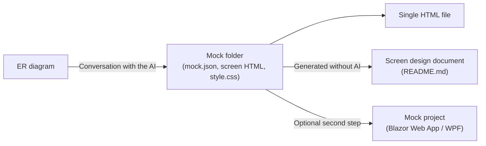
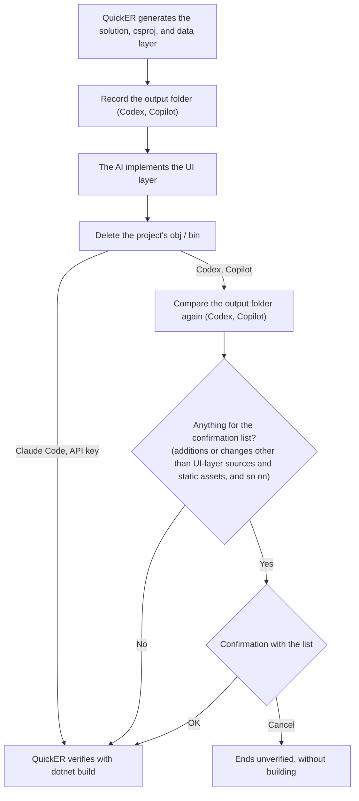

# Configuring AI chat

*English | [日本語](ai-chat.ja.md)*

From "AI Chat" on the toolbar, you can generate and edit ER diagrams by typing a prompt such as "Design the tables needed for order management on an e-commerce site" or "Add a shipping address to `orders`" into the chat box.
The same connection settings also drive the "AI Mock Generation" feature, which turns the current ER diagram into web mockup screens (see [AI mock generation](#ai-mock-generation) below).

This in-app chat edits the diagram currently open in the GUI.
To instead let an external AI agent (Claude Code, Codex, and so on) drive QuickER as part of its own workflow, use the [MCP server](mcp.md).

## Connection methods

The chat window has four connection tabs.
The API Key tab offers three providers of its own, which brings the total to six connection methods.

| Tab | Connection method | Authentication | Attachments |
|---|---|---|---|
| API Key | OpenAI | An OpenAI API key | Images and text |
| API Key | Claude (Anthropic) | An Anthropic API key | Images, PDFs, and text |
| API Key | Local LLM | An API key only for a server that requires one (optional) | Images and text |
| Codex | Codex CLI | The sign-in of an installed Codex CLI | Not supported |
| Claude Code | Claude Code | The sign-in of an installed Claude Code | Images, PDFs, text, and other binary files |
| Copilot | GitHub Copilot CLI | The sign-in of an installed GitHub Copilot CLI (a GitHub Copilot subscription is required) | Images only |

### 1. API key (the "API Key" tab)

| Provider | What you need |
|---|---|
| OpenAI | An OpenAI API key |
| Claude (Anthropic) | An Anthropic API key |
| Local LLM | An OpenAI-compatible local LLM (Ollama, LM Studio, llama.cpp, vLLM, and so on) |

Select a provider and model, then enter the API key.
When you enable the "Save" checkbox (for the API key), the key is **encrypted with Windows DPAPI (CurrentUser scope)** and stored under your user profile, and it is filled in automatically the next time you start (it is never stored in plain text).
The key is saved when you leave the key field, switch the provider, or close the window, not on every keystroke.
DPAPI CurrentUser protection is tied to your Windows user account, so how well the key is protected depends on that account staying secure.

Under "Local LLM" you give the endpoint URL of your server in the endpoint field, including the `/v1` part (the default is Ollama's `http://localhost:11434/v1`).
The API key is optional there: leave it empty for a server that requires no authentication, or enter one for a server that does.
The provider and endpoint you chose are remembered and restored the next time you start.

### 2. Codex (the "Codex" tab)

Reuses the sign-in of an installed Codex CLI, so no API key is needed.
Providers defined in `config.toml` are also shown as candidates.

### 3. Claude Code (the "Claude Code" tab)

Reuses the sign-in of an installed Claude Code, so no API key is needed.
The model is selected from an alias (such as `sonnet`).

### 4. Copilot (the "Copilot" tab)

Reuses the sign-in of an installed GitHub Copilot CLI, so no API key is needed (a GitHub Copilot subscription is required).
The model candidates are enumerated at runtime after connecting, and which models you can pick depends on your Copilot plan.
Leaving the model empty uses the CLI's default.

The connection tab you used last is remembered and selected automatically the next time you start.
The connection tabs are disabled while a response is in progress.
Interrupt the response before switching.
The tabs are also disabled while a new conversation is starting.

## What you can do

- **Generate a diagram**: describe your requirements and it creates tables, columns, and relationships.
  When a response that started from an empty diagram creates tables, the whole diagram is arranged automatically at the end of the response.
  The tables it created are arranged even when the response fails or is interrupted.
- **Edit a diagram**: add to, change, or delete from an existing diagram.
  Operations on tables, columns, and relationships go onto the Undo/Redo history, so you can revert them.
  Named-query edits are applied directly and are not part of that history.
  A single response runs at most 50 rounds of tool calls, and a response that reaches the limit is stopped as a failure.
- **Attachments**: attach files to pass existing design materials and the like as context.
  Each kind has its own size limit, and which kinds you can attach depends on the connection method (see the table under [Connection methods](#connection-methods)).
  Attachments are cleared when a response completes.
  They stay when the response fails or is interrupted, so you can send them again as they are.
- **AI mock generation**: generate web mockup screens from the current ER diagram, saved as a mock folder (see below)

## Displaying answers

In AI chat and AI mock generation, the AI's answers are shown as formatted Markdown.
Headings, bold and italic text, inline code, code blocks, bulleted and numbered lists, tables, quotes, horizontal rules, and links are formatted.
The "Markdown" check box in the chat header switches between the formatted view and the original text.
Each window remembers its own setting, and it is on by default.
While a response is in progress, the answer is shown as text.
It switches to the formatted view once the response ends, whether it completes, fails, or is interrupted.
A short answer made only of text gets a bubble as wide as the text, and an answer with a table, code block, or list uses the full bubble width.

- **Links**: only `http` and `https` links open, in your default browser and without confirmation.
  Hover over a link to see the URL it opens.
  Any other link (a `file:` link, a network path, a link that starts an app, and so on) is shown as plain text that cannot be clicked.
- **Images**: images are not loaded, and only their alternative text is shown.
  An image in an answer never makes QuickER connect to an outside server.
- **HTML**: HTML in an answer is not interpreted and is shown as written.
- **Deeply nested answers**: an answer nested too deeply to format, such as one with dozens of levels of quotes or emphasis, is shown as text.
- **Copying**: in the formatted view, copying copies the text as displayed.
  To copy the original Markdown, clear the "Markdown" check box and copy from the text view.

## AI mock generation

"AI Mock Generation" turns the current ER diagram into web mockup screens.
The result is saved as a **mock folder** (a `mock.json` manifest plus one HTML file per screen and a shared `style.css`), written live as you converse.

### Mock folder

Point the tool at an empty folder to start fresh, or at an existing mock folder to resume.
Give the folder as a full path; a relative path such as `mock` cannot start a conversation.
What you type in the folder field is applied when you stop typing, leave the field, or press Enter, and the folder's contents are read at that point.
No chat log is kept: resuming restores from the folder contents alone, so it works the same on every backend.
When you resume, QuickER tells the AI whether the ER diagram has changed since the conversation that last succeeded.
The diagram it compares with is recorded when the first turn of a conversation succeeds; a first turn that fails or is interrupted records nothing, and your next message starts the conversation again.
The screen-list sidebar lets you click through the screens, and the preview follows the links between them.

### Single HTML file

You can export the whole mock as a single self-contained HTML file.
In that file a link to another screen opens that screen but does not scroll to a `#section` inside it, and a link within a page keeps the current screen shown.
A screen whose HTML contains a stray `</section>` tag can disrupt the screen boundaries in that export, letting content bleed into the screens after it.

### Screen design document

The mock folder also yields a screen design document (`README.md`: a screen list, a Mermaid transition diagram, a screen-by-entity CRUD table, and a per-screen item table), generated deterministically without any AI.
Once exported it is rewritten automatically whenever a screen is saved or removed, and opening the folder on GitHub shows it as the folder's front page.
The AI declares each screen's entity usage (CRUD) as it saves screens, and those declarations render as a screen × entity table (the table is omitted when nothing is declared).

### Mock project

As an optional second step, you can generate a runnable **mock project** from the mock folder with any of the four backends.
The target is **Blazor Web App** (the default) or **WPF (.NET)**.
Blazor Web App is globally interactive with InteractiveServer, and reproduces the mock natively for the web by porting the screens' HTML and shared `style.css` as faithfully as possible.
QuickER generates the solution, the csproj files, and the data-layer code (Entity / EditModel / Mapper / an in-memory Repository, plus the QuickER Repository when the diagram's dialect supports it) deterministically from the ER model, so the AI only has to write the UI layer.
The mock folder is bundled under `design/mock/`, and the AI implements the UI from it.
The generated csproj references the same package versions as QuickER itself, including `SQLitePCLRaw` 3.0, which replaces the 2.1 version `Microsoft.Data.Sqlite` brings in so that the bundled SQLite is the version QuickER is tested with.
A Blazor project for SQL Server also references the fixed `System.Security.Cryptography.Pkcs` that overrides the vulnerable version `Microsoft.Data.SqlClient` brings in; WPF does not need it, because its shared framework already provides the package.

With Claude Code, Codex, or Copilot, the agent edits files and iterates on `dotnet build` until it passes or the run hits its overall time limit.
The agent is told to build the solution by name (`dotnet build <project name>.sln`), so another solution or project in the output folder does not get in its way.
With an API key, the model submits the files in a single deterministic pass (no self-correction, plus one fix round if the build fails), so it may fail more often.
Either way, QuickER verifies the result with its own final `dotnet build`.
An additional-instructions field lets you pass extra guidance for that implementation.

The figure shows the flow from generation to the final verification build.
For the permissions and the confirmation when QuickER builds the code the AI wrote, see [Notes](#notes).

If the output folder already holds files or folders, you get a confirmation listing them before anything is written.
Generation overwrites the solution, the csproj files and `README-QuickER.md` with the same names, which is how you regenerate under the same project name, and leaves every other file alone.
`Generated/` and `design/mock/` are emptied before they are written again, so nothing from the previous run is left there, such as code generated for another database or the HTML of a screen you have since removed.
If the mock folder you chose is one of those two folders, sits inside one, or contains one (for example the `design/mock/` of a previous output), generation stops before writing anything, so your mock folder is never deleted.

This second step is an aid for PoCs and prototyping.
Depending on the AI model and the connection method, build errors may remain.
When the final build fails, the generated files and the log are left in the output folder so you can fix them yourself.
An unexpected error during the run is reported the same way as a failure of the backend, and the log (`quickr-mock-generation.log`) is written in every case.
Interrupting stops the run at any point, including while the final build is running.

## Notes

- With the API key method, Codex, Claude Code, and Copilot alike, the diagram contents (table definitions, etc.) are sent to the AI provider you selected.
  When handling sensitive schemas, follow your organization's policy
- If you do not use the AI features, no API key or other configuration is required (the ER diagram designer and code generation work without connecting to the network)
- **What you attach, and the mock folder you resume from, reach the model as untrusted input.**
  An attached text file is inlined into the prompt as it is, and an attached image is passed through as it is.
  Resuming a mock folder feeds the manifest's text (screen names, descriptions, revision notes, transitions) into the prompt, with each screen's HTML coming back as the model reads it.
  None of that is inspected for instructions aimed at the AI, so material written by someone else can steer what the model does, up to and including the tools it calls.
  Treat a mock folder or a design document you received from a third party the way you would treat any other file from that source, and look at it before you open it here
- The second step (mock project generation) **builds AI-written code on your machine with your own privileges**.
  What the AI is allowed to do differs by backend

  | Backend | File writes | Command execution |
  |---|---|---|
  | API key | Submission through `emit_file` only. Limited to the output folder and to UI-layer source extensions (`.xaml` / `.cs` for WPF, `.razor` / `.css` / `.cs` for Blazor); build configuration files (`.csproj`, `Directory.Build.props` and the like) and anything under `Generated/`, `design/`, `obj/` or `bin/` are rejected, as is a path segment that ends in a dot or a space or contains `~`, which Windows could resolve to one of those folders | None |
  | Copilot | Auto-approved only under the output folder | Auto-approved only when the command references no URL and redirects nothing into a file, and then only when its paths all resolve under the output folder. When no path can be read out of the command line, only `dotnet` is auto-approved, and only when every part of the command is `dotnet`; anything else is refused (headless runs cannot ask you). Note that `dotnet` itself is not confined to that folder, so a subcommand that reaches outside it (installing a global tool and then running it, for example) is auto-approved as well |
  | Codex | Inside the sandbox (`workspace-write`) | Runs without approval inside the sandbox |
  | Claude Code | Edits files from the working folder (`Edit` / `Write` / `MultiEdit`) | `Bash` is unrestricted (it can run any command) |

- The API key method is designed so that QuickER hands the model a restricted tool set.
  The agent backends (Codex / Claude Code / Copilot) run the CLI you installed under that CLI's own permission model, so QuickER does not restrict them.
  If you generate a mock from an untrusted schema or from input you do not control, choose the API key method or run it in an isolated environment
- Every backend shares the same final verification build, which does the following.
  - **Names its own solution by path**, so a second solution sitting in the output folder cannot change what gets built
  - **Disables MSBuild's automatic imports**: `Directory.Build.props` / `.targets`, `Directory.Solution.props` / `.targets`, `Directory.Packages.props`
  - **Disables auto-response files** such as `Directory.Build.rsp`
  - **Throws away the MSBuild nodes and the Roslyn compiler server**, so that a build task the AI wrote does not stay resident
  - **Deletes the project's `obj` and `bin` right before building**, because files left in `obj` are picked up through a wildcard import

  A `global.json` or a `NuGet.Config` in a parent folder **still applies**: disabling those would cost you the pinned SDK and your feed configuration, which is the greater harm.
  The build has a time limit and is aborted if it runs over
- **The final build runs outside the agent's sandbox, with your privileges, and it is the one place where that boundary is crossed.**
  Codex and Copilot can write a csproj (or a `global.json`, or a `*.csproj.user`) inside their own sandbox, and this build would read it and run what it says.
  For those two backends, QuickER records the output folder right after scaffolding, compares file contents again right before the build, and asks you to confirm when anything outside UI-layer sources and static assets (`.cs`, `.razor`, `.xaml`, `.css`, `.js`, `.html`, images) was added or changed.
  The list is shown in full, so a legitimate addition such as an `appsettings.json` appears there too.
  A folder link (junction or symbolic link) is listed as a single entry and not followed, whatever its name.
  A folder whose contents QuickER cannot list, the output folder itself included, is listed every time, because what it holds cannot be compared (the output folder is shown as `.`).
  Anything QuickER could not delete from the project's `obj` / `bin` before the build is listed as well, because the build would read it.
  If you cancel, the build is not run and generation finishes with the project left **unverified**, with the files and the log still in the output folder for you to review.
  Claude Code and the API key method are not asked: Claude Code already runs any command it likes through `Bash`, so the build crosses no new boundary, and the API key method cannot submit a build file at all.
  Two limits are worth knowing. The comparison runs immediately before the build, while the executor's own processes may still be alive, so a file written back in that window is not detected.
  And the check only covers the output folder, not build files that already existed in a parent folder
- **Chat** is a different matter from the second step.
  It edits the diagram and never needs to touch your files, so each backend is given a throwaway working folder under `%TEMP%\QuickER` rather than the folder QuickER was started from.
  The Codex thread additionally declares the `read-only` sandbox
- On Windows, a CLI installed through npm arrives as a `.cmd` shim, which Windows launches through `cmd.exe`.
  QuickER builds the command line for `codex` and `claude` itself so that arguments cannot escape the quoting, and refuses to launch when an argument carries something `cmd` would still interpret.
  Arguments containing a line break are refused as well, because `cmd` truncates at the first newline and quoting cannot prevent it.
  Multi-line content is passed through a temporary file instead of an argument.
  `copilot` is started from inside the GitHub Copilot SDK, so QuickER does not compose its command line; only the resolved path is checked.
  For all three CLIs, a `.cmd` shim whose path contains `%` is refused, because `cmd` would expand it as an environment variable.
  For `copilot`, a path containing `!` is refused as well: QuickER cannot turn off `cmd`'s delayed expansion for a process the SDK starts.
  Each CLI is looked up on `PATH` by absolute folder only (a relative entry such as `.` is skipped) and started by that full path, and `cmd.exe` is started from the Windows system folder by full path rather than by name.
  Install the CLIs from a location you trust

## License note

The AI feature set (chat and mock generation = `QuickER.AI` / `AI.UI` / `AI.Chat` / `AI.Mock`) is covered by [PolyForm Noncommercial 1.0.0 plus additional grants](../LICENSE-NC.md), and those grants make the current releases **free for everyone, including commercial use**.
For a plain-language guide see [LICENSING.md](../LICENSING.md); the formal terms are [LICENSE](../LICENSE) and [LICENSE-NC.md](../LICENSE-NC.md).
