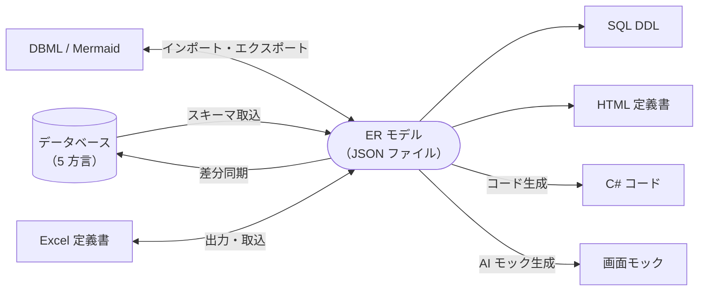
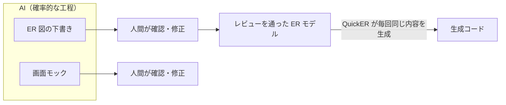

# QuickER が ER モデルを正本にする理由

*[English](overview.md) | 日本語*

QuickER は業務アプリケーションの .NET 開発を支援するための Windows 用ツールです。
ER 図の GUI デザイナーを中心に、DB との相互反映と AI 連携を備えています。
ER モデルからは DDL、C# コード、画面モック、テーブル定義書を生成できます。

では、なぜコードや DB ではなく、ER モデルを正本とするのでしょうか。

業務アプリケーションでは、同じスキーマ情報を何度も記述する必要があります。
「顧客」を一つ定義すれば、その列・キー・関連の情報は、DDL、エンティティクラス、画面にバインドするモデル、設計ドキュメントのそれぞれに現れます。
これらを手で書いていると、少しずつ食い違いが出てきます。

コードファースト開発はコードを正本にすることでこの問題に対処しました。
これにより DB との同期は保ちやすくなりましたが、スキーマのレビューには課題が残ります。
正規化の崩れや関連の張り忘れは、クラス定義を追うだけではなかなか見つかりません。
一方で、スキーマ全体を見渡すための表現は昔からあります。
テーブルを箱で、関連を線で表し、キーもひと目で確認できる ER 図です。
図にすれば、正規化の崩れも関連の張り忘れも、形の歪みとして目に入ります。
人間のレビューを通った図に基づく ER モデルであれば、正本として信頼できます。

ただし、図やモデルは一度作って終わりにはできません。
実装側の変更が反映されないまま放っておかれると、図は少しずつ実態からずれ、やがて誰も見なくなります。
このよくある失敗を避けるため、QuickER は二つの条件を満たすように作られています。
一つは、モデルと DB、モデルとテキストを双方向に変換できることです。
もう一つは、モデルから作る成果物を手で書き写さず、機械的に生成することです。
モデルに変更があれば、生成物はいつでもモデルから作り直せます。
モデルの外で起きた変更は、各種の取り込み機能でモデルに反映できます。

ER モデルと、変換・生成でつながるものは次のとおりです。

QuickER の狙いは ER モデルを正本とする開発の仕組みを提供することです。
同じスキーマ情報を何度も書き写す手間を最小限に抑え、高品質な業務アプリケーションをより速く、より少ないコストで開発できるようにします。

## ER モデル、DB、テキストの往復

ER モデルを正本にするなら、モデル定義をテキストで書いて Git で管理したくなるのは自然なことです。
ER 図は 1 つの JSON ファイルとして保存します。
JSON の中ではモデル定義（意味）と座標や色（見た目）が分かれていて、モデル定義だけを抜き出して保存することもできます。
どちらのファイルもソースコードと同じように Git でバージョン管理し、プルリクエストで差分を確認してレビューできます。
DBML や Mermaid といったテキスト形式のインポートとエクスポートにも対応しています。
使い慣れた形式で書いたものを取り込み、図で確かめるという使い分けもできます。

稼働中の DB との間でも、同じようにスキーマの変更を相互に反映できます。
SQL Server、PostgreSQL、MySQL、Oracle、SQLite の 5 つの方言に対応しており、DB からスキーマを取り込めます。
反対に、モデルと DB の差分を検出し、DB へ反映するための同期スクリプトも生成できます。
コードファーストで開発してきたアプリケーションなら、最初のモデルは既存 DB から作れます。

テーブル定義書にも同じ仕組みを使えます。
モデルから Excel の定義書を出力し、手で修正したものを取り込めます。
参照するだけなら、単一ファイルで完結する HTML の定義書も出力できます。
定義書はモデルからいつでも再生成できるため、古くなった箇所を定義書の中から探して直す必要はありません。

## AI との分業

取り込める DB もデータ元もない、まっさらな新規開発ではどうすればよいでしょうか。
白紙のキャンバスに数十のテーブルを作るには、相応の手間がかかります。
この初期設計の手間を AI チャット機能が受け持ちます。
「EC サイトの受注管理のテーブルを設計して」と AI に依頼すると、ER 図のたたき台が生成され、その後も会話を通じて修正できます。
AI の利用方式は、API キー、ローカル LLM、Codex、Claude Code、Copilot（GitHub Copilot CLI）から環境に合わせて選べます。

また、AI は ER モデルから Web 画面のモックも生成します。
生成物は画面ごとの HTML と共有スタイルを収めたモックフォルダに随時保存されます。
保存された画面はプレビュー画面で確認しながら、会話を通じて修正できます。
モックからは単一の HTML や設計ドキュメント（画面一覧、遷移図、画面とエンティティの CRUD 表）も機械的に生成できます。
これらを関係者と共有すれば、画面イメージも含めて、設計の早い段階で目線を合わせられます。

追加の工程として、モックフォルダから Blazor Web App または WPF のモックプロジェクトを生成することもできます。
データ層はモデルから機械的に生成し、画面の UI は AI が実装します。
最後に QuickER 自身が `dotnet build` を実行し、実際にビルドできるかを確認します。
ただし、生成物の精度は AI のモデルの能力と方式（API キー／エージェント型）によって変わるため、エラーが残ることがあります。
この機能はあくまでも PoC やプロトタイピングのための補助という位置付けです。

こうした AI の使い方は、アプリを丸ごと AI に書かせる開発とは構造が違います。
AI が一から書く場合、確率的な出力がコードベースの全層に広がり、人間はそれをコードレビューで後から追いかけることになります。
QuickER の流れでは、AI の確率的な工程は ER 図の下書きと、設計の補助となるモックの生成にとどまります。
人間はそれぞれの生成物を確認し、必要な修正を加えます。
レビューを通った後は、QuickER が ER モデルから毎回同じ内容のコードを生成します。
ER モデルさえ確かなら、生成コードの出来が日によって変わることはありません。
人間が確認できる場所を決めたうえで AI を使う、という分業です。

この流れを図にすると次のとおりです。

## 生成コードが引き受ける範囲

レビューを通った ER モデルからは、どのようなコードが出てくるでしょうか。
QuickER が生成するのは、モデル定義から機械的に決まるものだけです。
アプリケーション固有の処理は、開発者が実装する領域として切り分けてあります。
生成されるのは次の 3 種です。

- **スキーマ定義**：エンティティクラス、列ごとの値オブジェクト、列定義に基づく検証コードを生成します。
  値オブジェクトを使うと、顧客 ID と商品 ID が別の型になり、取り違えをコンパイル時に検出できます。
  また、文字列型の主キーの値オブジェクトには、キーの値として GUID を生成する機能もあります。
- **データ操作**：同じインターフェイスを実装する二種類の Repository を生成します。
  一つは軽量な QuickER 版（現在は SQL Server と SQLite に対応）、もう一つは EF Core 版です。
  インターフェイスが共通なので、DI 登録を一行変えるだけで実装を切り替えられます。
  グループ化や集計などのクエリは、名前付きクエリとして ER 図と一緒に作成・保存できます。
  作成した名前付きクエリは、Repository のメソッドとして自動生成されます。
  このほか、Repository には生 SQL を実行するための汎用的なメソッドも用意されています。
  また、DB へ直接接続せず、Web API 経由でリモートの DB にアクセスする Repository も生成できます。
  この場合、リモート接続用のインターフェイスや、HTTP + JSON を使うクライアントおよびサーバーのコードが追加で生成されます。
  リモート接続への切り替えもやはり DI 登録を一行変えるだけで済みます。
- **UI バインディング用モデル**：画面に直接バインドできる EditModel と、EditModel とエンティティとの相互変換を行う Mapper を生成します。
  EditModel は画面からの入力値を文字列として受け取ります。
  検証に成功した値は確定値として、失敗した場合はエラー情報として保持します。
  Mapper は、EditModel が保持する確定値と変更状態だけをエンティティに反映するため、不正な入力値がエンティティに入り込むことを防げます。
  変換を Mapper が引き受けるので、画面ごとに値の変換やコピーを書き直す手間もなくなります。

これらが自動生成されるので、開発者はデータの定義や操作を何度も書かずに済みます。
その分の時間を、本番用の画面デザインやビジネスロジックの実装へ充てられます。

## 生成コードの独立性

コード生成ツールには、生成されたコードがツール側の制限に縛られて、手を加えるほど保守が難しくなるという不安がつきまといます。
この不安に応えるため、QuickER の生成コードは次のような設計になっています。

- **UI フレームワーク非依存**：生成コードは特定の UI ライブラリに依存せず、デスクトップアプリでも Web アプリでも使えます。
- **クロスプラットフォーム**：QuickER 本体は Windows 用ですが、生成コードは Windows、macOS、Linux の .NET 上で動作します。
- **自己完結**：既定ではランタイム（生成コードの基底クラス・共通部品）をインラインで出力するため、生成コードだけで完結します。
  生成コードを最小限にしたければ、ランタイムを NuGet パッケージとして参照する方式に切り替えることもできます。
- **partial クラスによる拡張**：生成コードとは別のファイルに partial クラスを書けば、生成されたファイルに触れずに、検証の追加や表示名の変更などができます。
  生成コードを更新しても、開発者が書いた partial クラスのコードは失われません。

生成されたコードはライセンス上も利用者の成果物となり、制限なく利用、改変、再配布できます。
生成された機能では足りなければ、partial クラスで自由に拡張してください。

## 現状とこれから

QuickER は .NET 向けの Windows 用ツールとして開発されており、現在のコード生成対象は C# です。
ER モデル自体は特定のプログラミング言語に依存しないテーブル・列・関連で構成されており、C# への変換はその上に乗った生成機能の 1 つにすぎません。
他の言語への対応は今後の開発で広げていきたい領域です。

コード生成を使わない場合でも、DB やテキストと相互に反映できる ER 図ツールとして使えます。
こちらも、より使いやすくしていく余地があります。

QuickER のリポジトリには、ER モデルの設計、コード生成、実行までを一通り試せるサンプル（[samples/ec-order](../samples/ec-order)）が含まれています。
SQLite のファイル DB を使うため、.NET 10 SDK があれば、クローン直後にそのまま実行できます。
まずはこのサンプルを動かしてみてください。
